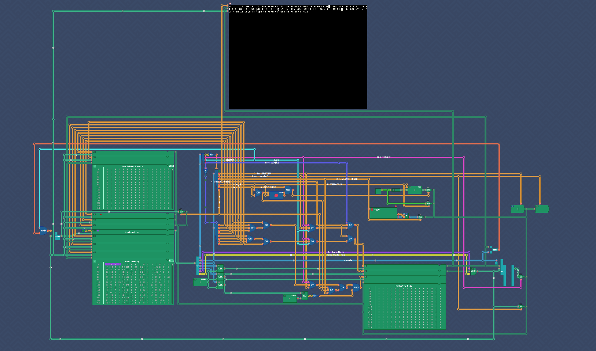
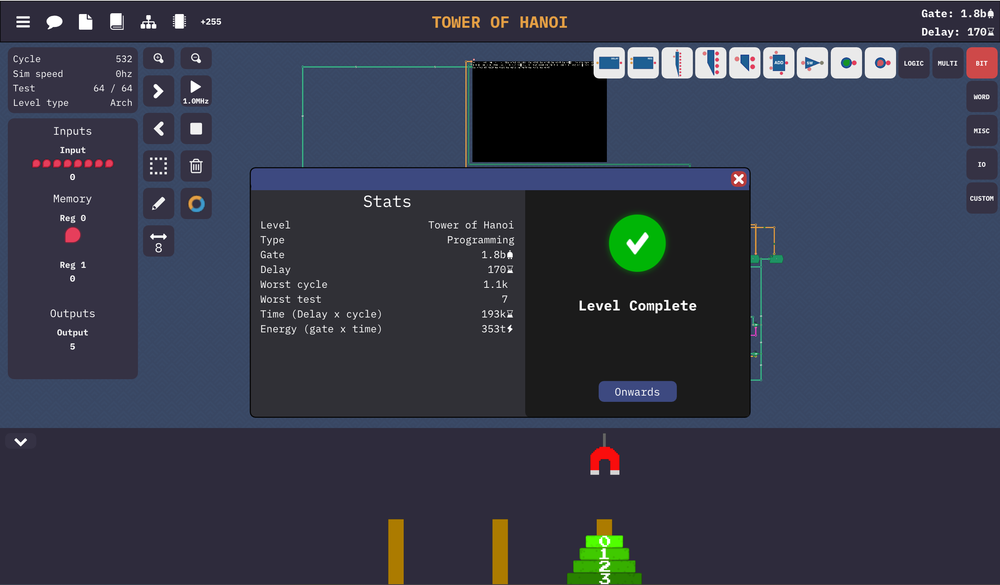

# Symphony 32-bit CPU

A 32-bit CPU built in **Turing Complete**, implementing the game's **Symphony instruction set** with a self-designed circuit and assembly programs.

This project documents my progression through digital logic, CPU construction, and assembly programming. I completed all game levels and unlocked all **10 Steam achievements**.

## My Contribution

- Designed and connected the CPU circuit to implement the Symphony ISA.
- Implemented the datapath and control logic for arithmetic, logic, register access, memory operations, and branching.
- Wrote assembly programs for stack operations and a recursive Tower of Hanoi solver.
- Tested the implementation in Turing Complete; the Hanoi solution passed all **64 in-game test cases**.
- Exported the circuit to Verilog for inspection and documentation.

The Symphony architecture and ISA are provided by Turing Complete. The CPU circuit is my implementation. The game also provides the Hanoi algorithm in pseudocode, which I translated into assembly. The Verilog files and built-in component modules are generated by the game's exporter.

<!-- Add the circuit overview here after uploading assets/cpu-overview.png:

-->

## CPU Overview

| Feature | Implementation |
| --- | --- |
| Datapath | 32-bit |
| Base instruction size | 32 bits / 4 bytes |
| Register encoding | 4-bit register IDs: `zr`, `r1–r13`, `sp`, and `flags` |
| Register storage | RAM with two 32-bit read ports and one 32-bit write port |
| Arithmetic and logic | ADD, SUB, NAND, OR, AND, NOR, XOR |
| Shifts | Logical left, logical right, and arithmetic right |
| Comparison | Equality, unsigned less-than, and signed less-than |
| Control flow | Register/immediate jumps and conditional branches |
| Main memory | 16 MiB, byte-addressed, with 8/16/32-bit data access |
| External memory | Separate 16 MiB memory with 32-bit read/write access |
| Byte order | Big-endian |
| Exported standard I/O | 8-bit input and 32-bit output, with enable signals |
| Stack | Downward-growing; 32-bit stack pointer initially set to zero |

The program counter normally advances by four bytes. Branch logic selects a target address when a jump is taken. Instruction fetch and data access use separate ports on the same main-memory instance.

The comparison result is stored in `flags`: bit 0 records equality, bit 1 unsigned less-than, and bit 2 signed less-than.

Stack operations use the main memory. With `sp = 0`, the first four-byte allocation wraps the 32-bit pointer to `0xFFFFFFFC`. The memory interface uses the low 24 address bits, mapping this to `0xFFFFFC`, the start of the final four bytes of main memory.

## Assembly Examples

### Stack Operations

`programs/stack_io.asm` implements a last-in, first-out stack using basic arithmetic and memory instructions:

- A nonzero input is pushed onto the stack.
- An input of zero pops the top value and sends it to the output.

For example, inputs `10, 20, 30, 0, 0, 0` produce outputs `30, 20, 10`.

A push is implemented as:

```asm
sub sp, sp, 4
store_32 [sp], r1
```

A pop is implemented as:

```asm
load_32 r1, [sp]
add sp, sp, 4
```

Zero is reserved as the pop command. The program assumes valid input sequences and does not check for stack underflow or overflow.

### Recursive Tower of Hanoi

`programs/hanoi.asm` solves the game's Tower of Hanoi challenge using recursive function calls.

The program reads four inputs: the largest disk index, source peg, destination peg, and spare peg. Disk numbering starts at zero, so the tested index range of 2–4 represents 3–5 disks.

Registers `r1–r4` pass arguments. Each call saves `r5–r8` on the stack, then uses them to retain its own arguments across recursive calls. The program restores these registers before returning.

Each disk move outputs the sequence `source, 5, destination, 5`, moving the electromagnet and toggling it to pick up and release a disk.

**Result: all 64 in-game tests passed.**

The ISA's `push`, `pop`, `call`, and `ret` expand into sequences of base instructions. Each active Hanoi call uses 20 bytes of stack space: 4 bytes for its return address and 16 bytes for saved registers. For the largest tested input, the calculated peak stack usage is 100 bytes.

<!-- Add the test result here after uploading assets/hanoi-passed.png:

-->

## Repository Organization

The repository is being organized around the following files:

| Path | Purpose |
| --- | --- |
| `docs/architecture.md` | Datapath, control logic, memory, and stack details |
| `docs/isa.md` | Human-readable instruction set reference |
| `docs/validation.md` | In-game test results and completion records |
| `isa/symphony_isa.txt` | Assembly instruction definitions and encodings |
| `programs/` | Assembly examples and their input/output descriptions |
| `verilog/symphony.v` | Original exported top-level circuit |
| `verilog/symphony.json` | Export metadata |
| `verilog/builtin_components/` | 28 exported component modules |
| `assets/` | Circuit, test-result, and achievement screenshots |

## Validation and Export Status

The CPU and Hanoi program have been tested together in Turing Complete. All game levels are complete, and all 10 Steam achievements are unlocked.

The Verilog export has been inspected for structure and module dependencies. **External Verilog compilation, simulation, and FPGA operation have not yet been verified.** The exported source contains width and part-select issues that need review before external use.

The two exported memory initialization files contain only zeros. They initialize main and external memory; they do **not** contain the assembly examples' machine code. Running an example outside the game will require loading its encoded instructions and supplying a suitable testbench.

The assembly examples target the game's Symphony environment. The Verilog export is not a replacement for a native Turing Complete circuit save.

## What I Learned

- How instruction encodings control register selection and data movement.
- How ALU results and comparison flags support arithmetic and branching.
- How memory reads, writes, and address truncation affect program execution.
- How a stack preserves return addresses and register values across recursive calls.
- Why a working circuit in one simulator still needs validation after HDL export.

